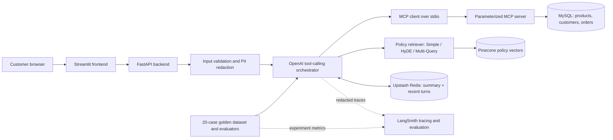

# eCommSupport-AI architecture

## System design

## Request flow

1. Streamlit posts the question, server-generated session ID, customer context, and retrieval strategy to FastAPI.
2. FastAPI validates the payload. The backend applies bounded-input and injection/off-topic guardrails before provider calls.
3. The orchestrator uses OpenAI function calling when configured. Structured-data operations are routed through the stdio MCP client; the MCP server exposes only three fixed functions and the SQLAlchemy service uses bound parameters.
4. Policy questions use Pinecone with Simple RAG, HyDE, or Multi-Query. Without configured provider services, the local demo uses the bundled policy corpus; this is clearly a development fallback.
5. The answer is grounded in tool results and retrieved passages. The response includes source metadata, model, tools used, and latency.
6. Conversation memory retains the latest configured number of turns and compacts older context. When Redis is configured, the serialized bounded state is stored per session; without Redis it remains process-local.
7. Agent traces pass through PII redaction. The golden evaluation measures expected-tool selection, policy grounding/hallucination, and latency; retrieval benchmarking reports Recall@k and MRR.

## Trust boundaries and controls

- The LLM never receives a SQL execution function or arbitrary table/query access. It can call only the named MCP tools.
- Product and order IDs are length-checked; order lookup requires both order ID and customer ID, and the query filters on both. `place_order` bounds quantity and uses a transaction with an inventory row lock where supported.
- In the demo, the customer ID is supplied by the UI and is not proof of identity. Production must derive it from authenticated server-side identity.
- Retrieved passages and user input are treated as untrusted text in the system prompt. Deterministic guardrails reject common injection/off-topic patterns before model use.
- PII redaction is applied to LangSmith trace inputs/outputs and memory fields. Provider configuration and API errors are not silently converted to successful answers.
- `place_order` is a write operation; the example only calls it after an explicit purchase request. A deployed commerce system must add an authenticated confirmation and idempotency/approval workflow.

## Source map by milestone

### Milestone 1 — MCP and structured MySQL

- Frontend: `frontend/app.py`
- Backend service: `backend/database.py`
- MCP server/client: `backend/mcp_server.py`, `backend/mcp_client.py`
- Database definition and setup: `database/schema.sql`, `scripts/init_db.py`
- Tests: `tests/test_database.py`, `tests/test_api.py`

### Milestone 2 — advanced RAG

- Frontend strategy control: `frontend/app.py`
- Retrieval implementation: `backend/rag.py`
- Policy corpus and Pinecone ingestion: `data/policies.jsonl`, `scripts/ingest_policies.py`
- Benchmark and retrieval metrics: `scripts/benchmark_retrieval.py`, `backend/evaluation.py`
- Tests: `tests/test_rag.py`

### Milestone 3 — orchestration and memory

- Frontend: `frontend/app.py`
- API: `backend/api.py`
- Orchestration/tool calling: `backend/agent.py`
- MCP bridge: `backend/mcp_client.py`
- Memory: `backend/memory.py`
- Tests: `tests/test_agent.py`, `tests/test_memory.py`

### Milestone 4 — safety and context/cost

- Frontend: `frontend/app.py`
- Guardrails and trace redaction: `backend/guardrails.py`
- Bounded rolling memory, summary, model routing: `backend/memory.py`, `backend/agent.py`
- Tests: `tests/test_guardrails.py`, `tests/test_memory.py`

### Milestone 5 — evaluation

- Frontend observability: response metadata displayed in `frontend/app.py`
- Golden set runner and evaluators: `scripts/run_evaluations.py`, `backend/evaluation.py`
- Golden cases: `data/golden_dataset.jsonl`
- Tests: `tests/test_api.py`, `tests/test_app.py`, plus backend test suite
